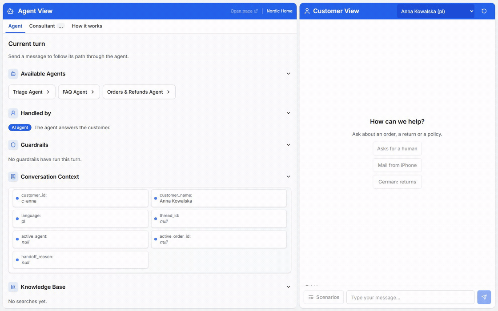
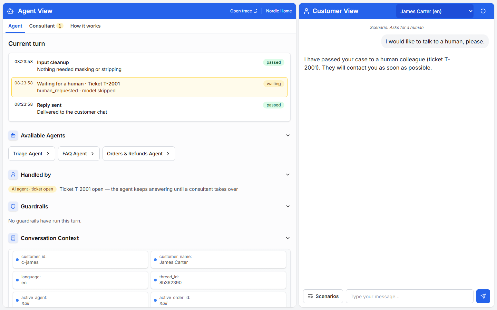
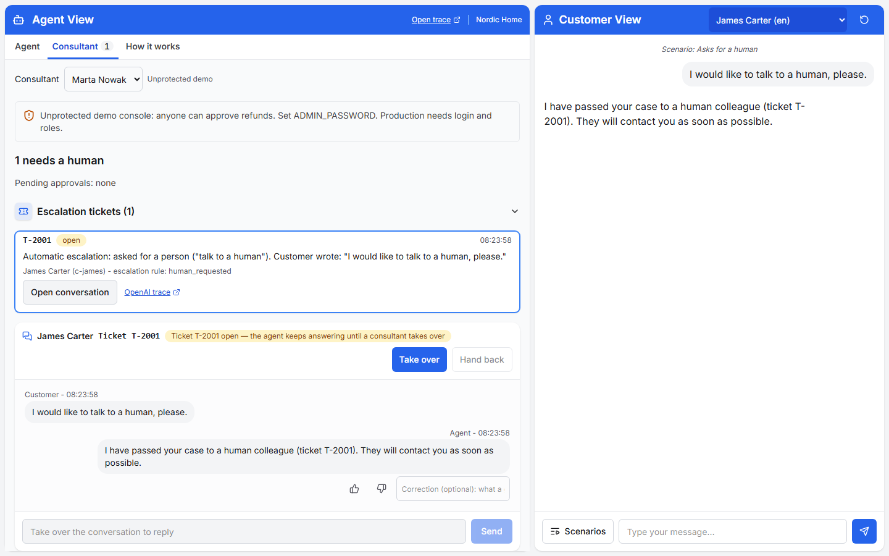
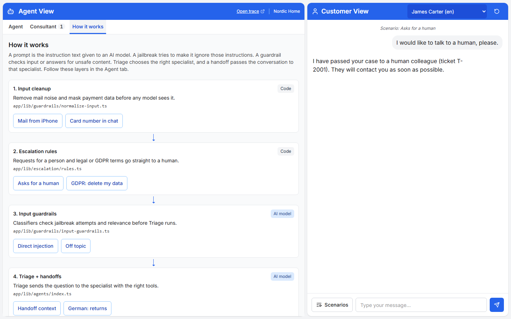

Unofficial — not affiliated with OpenAI.

# Nordic Home: a TypeScript customer-support agent demo

A multi-agent support desk on the OpenAI Agents SDK for JS where you can inspect each decision, approve refunds and take over the chat.



[Watch the WebM](docs/media/support-demo.webm) · [Media sources](docs/media/README.md) · [Run locally](#quick-start) · [Read the architecture](.plan/ARCH.md)

## Inspired by the OpenAI demo

Inspired by [openai/openai-cs-agents-demo](https://github.com/openai/openai-cs-agents-demo) (Python backend, Next.js UI). This project is independent and not affiliated with or endorsed by OpenAI. It keeps triage and specialist handoffs, the two-panel layout, and the Agent View that exposes what happens inside a turn.

This version uses TypeScript end to end: the OpenAI Agents SDK for JS, Vercel AI SDK chat and one Next.js process. It adds human approvals and a consultant console, code-enforced business rules, secure forms, guest verification, evals and browser smoke checks. The code is written to be read: TSDoc explains each module; `// SECURITY:` marks trust decisions and `// INTERVIEW:` marks teaching points.

## Capabilities

Explore a furniture-shop support conversation from the customer chat and the Agent View, then open the Consultant tab when a person needs to decide or reply. The start screen and Scenarios menu share the runnable examples. Multi-step stories suggest an editable next customer message; Send remains your choice.

### Scenario catalog

Choose a UI example to start a fresh conversation, or pass stable IDs to `just eval` to check real-model behavior. Evals need an API key and incur provider costs. Some fixtures require pre-existing synthetic state and appear only in the eval catalog. The table includes those fixtures without exposing their setup values.

<!-- scenarios:generated:start -->

All 49 synthetic scenarios from [scenarios.json](app/data/scenarios.json), grouped by category.

Steps count customer messages. Widget clicks and consultant decisions are additional actions. UI + eval examples appear in the start screen and Scenarios menu; eval-only examples require fixture setup.

<details>
<summary>Address changes (4)</summary>

| Scenario | Stable ID | Steps | Availability |
| --- | --- | --- | --- |
| Change a delivery address and confirm | `address-change-confirm` | 3 | UI + eval |
| Try changing a delivered order's address | `address-delivered-refused` | 1 | UI + eval |
| Try an address with the wrong postcode format | `address-country-postcode-refused` | 1 | UI + eval |
| Try changing delivery to another country | `address-country-change-refused` | 1 | UI + eval |

</details>

<details>
<summary>Data collection (4)</summary>

| Scenario | Stable ID | Steps | Availability |
| --- | --- | --- | --- |
| Report damage over several messages | `claim-slot-filling` | 4 | UI + eval |
| Try to file an incomplete damage claim | `claim-premature-submit` | 1 | UI + eval |
| Type a bank account in chat | `iban-typed-in-chat` | 1 | UI + eval |
| Report damage, approve a refund, then ask for a person | `damage-refund-human` | 4 | UI + eval |

</details>

<details>
<summary>Guest mode (3)</summary>

| Scenario | Stable ID | Steps | Availability |
| --- | --- | --- | --- |
| Verify as a guest, then ask about my order | `guest-verify-success` | 2 | UI + eval |
| Ask about an order before verification | `guest-no-data-before-verify` | 1 | UI + eval |
| Try incorrect guest verification details | `guest-verify-lockout` | 4 | UI + eval |

</details>

<details>
<summary>Human handoff (8)</summary>

| Scenario | Stable ID | Steps | Availability |
| --- | --- | --- | --- |
| Ask for a person while upset | `angry-customer` | 1 | UI + eval |
| Talk to a person | `human-request` | 1 | UI + eval |
| Ask to delete my personal data | `gdpr-delete` | 1 | UI + eval |
| Escalate a legal complaint | `legal-threat` | 1 | UI + eval |
| Try two requests that trip guardrails | `double-guardrail-trip` | 2 | UI + eval |
| Complain without asking for a person | `angry-no-keywords` | 1 | UI + eval |
| Ask what happens after escalation | `escalation-next-step` | 1 | UI + eval |
| Follow a consultant's private note | `staff-handback-context` | 1 | Eval only (fixture setup) |

</details>

<details>
<summary>Knowledge (4)</summary>

| Scenario | Stable ID | Steps | Availability |
| --- | --- | --- | --- |
| Ask a question outside the knowledge base | `kb-unknown` | 1 | UI + eval |
| Unknown answer, then accept escalation | `kb-unknown-yes` | 2 | UI + eval |
| Unknown answer, then offer a person | `kb-unknown-offers-escalation` | 1 | UI + eval |
| Unknown answer, then decline escalation | `escalation-offer-declined` | 2 | UI + eval |

</details>

<details>
<summary>Languages (2)</summary>

| Scenario | Stable ID | Steps | Availability |
| --- | --- | --- | --- |
| Ask about returns in German | `german-returns` | 1 | UI + eval |
| Switch the conversation language | `language-switch` | 2 | UI + eval |

</details>

<details>
<summary>Orders (4)</summary>

| Scenario | Stable ID | Steps | Availability |
| --- | --- | --- | --- |
| Ask about an order from an email | `iphone-signature` | 1 | UI + eval |
| Choose from my orders | `order-picker` | 1 | UI + eval |
| Keep the selected order during handoff | `handoff-context` | 1 | UI + eval |
| Read my current delivery address | `order-delivery-address` | 1 | UI + eval |

</details>

<details>
<summary>Refunds &amp; approvals (12)</summary>

| Scenario | Stable ID | Steps | Availability |
| --- | --- | --- | --- |
| Return a chair within the deadline | `refund-in-policy` | 1 | UI + eval |
| Request a refund that needs approval | `refund-over-threshold` | 3 | UI + eval |
| Try a return after the deadline | `refund-expired` | 1 | UI + eval |
| A consultant refuses the refund | `refund-rejected` | 1 | UI + eval |
| Try to refund an already refunded order | `refund-already-refunded` | 1 | Eval only (fixture setup) |
| Request more than the remaining refund | `refund-over-remaining` | 2 | UI + eval |
| Refund a cash-on-delivery order | `cod-refund-needs-iban` | 1 | UI + eval |
| Refund to a saved bank account | `cod-refund-with-iban` | 1 | Eval only (fixture setup) |
| Create a refund, cancel it, then cancel again | `refund-cancel-repeat` | 3 | UI + eval |
| Try cancelling a paid refund | `refund-cancel-paid-refused` | 1 | Eval only (fixture setup) |
| Review refund details, then confirm | `refund-confirmation-choices` | 2 | UI + eval |
| Review refund details, then decline | `refund-confirmation-declined` | 2 | UI + eval |

</details>

<details>
<summary>Security &amp; guardrails (8)</summary>

| Scenario | Stable ID | Steps | Availability |
| --- | --- | --- | --- |
| Ask the assistant to ignore its rules | `injection-direct` | 1 | UI + eval |
| Hide instructions in a delivery question | `injection-hidden` | 1 | UI + eval |
| Ask about someone else's order | `foreign-order` | 1 | UI + eval |
| Ask to see the assistant's instructions | `prompt-extraction` | 1 | UI + eval |
| Ask an unrelated question | `off-topic` | 1 | UI + eval |
| Type a card number in chat | `card-number` | 1 | UI + eval |
| Ask for a relative's order | `social-engineering` | 1 | UI + eval |
| Read an order note containing hidden instructions | `injection-order-note` | 1 | UI + eval |

</details>

<!-- scenarios:generated:end -->

<details>
<summary>Maintain the scenario catalog</summary>

Edit [scenarios.json](app/data/scenarios.json), then run:

```sh
node scripts/generate-readme-scenarios.mjs --write
```

Review the README diff. `just check` runs the same generator with `--check` and fails if the catalog is stale; check mode never rewrites README. The generator uses all fixtures, including examples that need eval-only setup.

</details>

### Guardrails and business rules

The model proposes actions. Tool and runtime code enforce access and business rules. The following source map shows where each layer runs and what it constrains.

<details>
<summary>Open the guardrail and code-rule source map</summary>

| Layer | What it stops or constrains | Source |
| --- | --- | --- |
| Input cleanup | Removes recognized mail signatures, quoted lines and invisible characters; caps the text passed to inference. | [normalize-input.ts](app/lib/guardrails/normalize-input.ts), [config.ts](app/lib/config.ts) |
| Jailbreak classifier | Flags attempts to override instructions, extract the prompt or request disallowed actions. Classification is probabilistic. | [input-guardrails.ts](app/lib/guardrails/input-guardrails.ts) |
| Relevance classifier | Flags unrelated requests while using conversation context to interpret short replies. Classification is probabilistic. | [input-guardrails.ts](app/lib/guardrails/input-guardrails.ts) |
| Output leak detection | Blocks the configured canary, matching prompt/private-note excerpts, foreign fixture strings and supported sensitive-number patterns. | [leak-detect.ts](app/lib/guardrails/leak-detect.ts), [leak-guardrail.ts](app/lib/guardrails/leak-guardrail.ts) |
| Masking and secure forms | Masks recognized cards, IBANs and phones before model input/events. Secure forms validate supported values and store them in the server vault; tools use their status. | [pii.ts](app/lib/guardrails/pii.ts), [mask.ts](app/lib/sensitive/mask.ts), [secure-forms.ts](app/lib/tools/secure-forms.ts), [vault.ts](app/lib/sensitive/vault.ts) |
| Thread access, history and channels | Checks signed thread cookies, keeps history on the server and projects only allowlisted customer events. | [thread-access.ts](app/lib/security/thread-access.ts), [thread-credential.ts](app/lib/security/thread-credential.ts), [event-visibility.ts](app/lib/runtime/event-visibility.ts), [turn.ts](app/lib/runtime/turn.ts) |
| Order ownership | Resolves orders through the verified session customer and rechecks structured selections; customer/model text cannot authorize a foreign order. | [helpers.ts](app/lib/tools/helpers.ts), [orders.ts](app/lib/tools/orders.ts), [selection.ts](app/lib/runtime/selection.ts) |
| Refund policy and approval | Requires a delivered owned order, a valid positive amount within the remaining refundable value and the return window. Amounts above the configured threshold pause for human approval; execution rechecks policy. | [refund-rules.ts](app/lib/tools/refund-rules.ts), [refund.ts](app/lib/tools/refund.ts), [approval-flow.ts](app/lib/runtime/approval-flow.ts) |
| Payout and cancellation | Requires payout details for cash-on-delivery refunds. Only the owner can cancel an unpaid refund; ambiguous histories require a choice and paid refunds cannot be reversed. | [refund-payout.ts](app/lib/tools/refund-payout.ts), [cancel-refund.ts](app/lib/tools/cancel-refund.ts) |
| Escalation rules | Opens a ticket for explicit human/legal/GDPR requests and repeated guardrail trips or tool errors through deterministic rules. | [rules.ts](app/lib/escalation/rules.ts) |
| Public request rate limits | Caps thread, chat and photo bursts in bounded fixed windows using configured proxy/IP and thread buckets. These limits apply in public mode. | [public-rate-limit.ts](app/lib/security/public-rate-limit.ts) |
| Guest verification limits | Requires a matching fixture email and optional matching postal code before exposing order data; counts attempts per thread and per order and keeps failures non-disclosing. | [verification.ts](app/lib/guest/verification.ts), [order-attempts.ts](app/lib/guest/order-attempts.ts) |
| Address validation and confirmation | Uses the order's trusted country/postcode rules, refuses delivered/foreign destinations and revalidates the stored draft on the current Confirm click. | [address-schema.ts](app/lib/address/address-schema.ts), [address-flow.ts](app/lib/address/address-flow.ts) |
| Claims and photo uploads | Validates required claim fields and supported upload format/size before accepting them. | [claim-schema.ts](app/lib/claims/claim-schema.ts), [photo-validate.ts](app/lib/claims/photo-validate.ts) |
| Structured reply choices | Checks the current thread, turn and offer nonce; refund confirmation retains the normal tool and approval checks. | [quick-replies.ts](app/lib/runtime/quick-replies.ts), [reply-choices.ts](app/lib/tools/reply-choices.ts) |
| Consultant access and CSRF | Protects console requests with the configured local authentication or public visitor-cookie scope, and checks write origins. | [proxy.ts](app/proxy.ts), [auth.ts](app/lib/admin/auth.ts), [csrf.ts](app/lib/admin/csrf.ts), [visitor-access.ts](app/lib/admin/visitor-access.ts) |
| Staff tone warning | Warns before takeover or delivery for supported Polish/English rude-word matches. Sending anyway requires an acknowledgement bound to the exact text, consultant and thread, recorded in the audit. | [staff-reply.ts](app/lib/admin/staff-reply.ts) |
| Visitor API key boundary | Requires a public visitor's own key for model requests and approval resume; keeps request keys out of events and serialized state. | [request-key.ts](app/lib/security/request-key.ts), [model-access.ts](app/lib/runtime/model-access.ts), [visitor-key.tsx](app/components/visitor-key.tsx), [key-transport.ts](app/lib/client/key-transport.ts) |
| Runtime and storage bounds | Caps agent turns, input/history and retained threads/photos/vault entries. State is in one process and is cleared on restart. | [config.ts](app/lib/config.ts), [history.ts](app/lib/runtime/history.ts), [threads.ts](app/lib/runtime/threads.ts), [store.ts](app/lib/data/store.ts), [vault.ts](app/lib/sensitive/vault.ts) |

</details>

Classifiers, masking patterns, prompt-excerpt matching and tone word lists have false positives and false negatives. They cover the implemented patterns and fixtures; production needs broader abuse testing, real identity/authorization and durable operations. Guest verification here matches fixture data supplied in chat and does not prove control of a mailbox. Public rate limits depend on correct trusted-proxy configuration.

### Human decisions and feedback

- **Approve or reject refunds.** A request above the configured limit pauses the Agents SDK run. A consultant decides; saved state resumes through the same rules and the decision is audited.
- **Take over and reply.** The queue and arrival badge surface new work. A consultant writes in the selected conversation and starts helping with one action; another consultant's owned thread remains protected.
- **Hand back with guidance.** An optional private note guides that conversation's fresh and resumed runs. It appears only in inspector/admin views and cannot override code rules.
- **Review a tone warning.** The first warning sends nothing and takes over nothing. Editing invalidates the acknowledgement; an explicit Send anyway records the override.
- **Rate and correct answers.** Ratings and corrections export as future eval fixtures. They do not automatically train the model or rewrite other conversations.
- **Confirm customer actions.** Order choices, address Confirm/Cancel and structured Yes/No offers keep decisions explicit. Secure forms keep supported bank/contact values out of model text; damage photos are optional.
- **Inspect a turn.** Agent View shows the current path, context, policy sources and masked Run log groups. Source chips open the article locally while the customer chat stays visible.

The consultant selector, customers, orders, refunds and audit records are synthetic demo state. A production system needs authenticated staff identities, authorization and durable records.

<details>
<summary>Agent View: trace, handler and context</summary>



</details>

<details>
<summary>Consultant: selected ticket and its conversation</summary>



</details>

<details>
<summary>How it works: code paths and actions for each layer</summary>



</details>

## Quick start

From a checkout, with Node 22.18+, Corepack/pnpm and [just](https://github.com/casey/just) on PATH:

```sh
just setup
```

Supply `OPENAI_API_KEY` through the environment or copy [app/.env.example](app/.env.example) to the git-ignored `app/.env.local` and fill in the key. Do not commit it.

```sh
# macOS/Linux
export OPENAI_API_KEY="your-key"
# PowerShell: $env:OPENAI_API_KEY = "your-key"
just dev
```

Open the address printed by Next.js (port 3100). Agent, Consultant and How it works share one page; `/admin` redirects to `/?tab=consultant`. Without just, use `corepack pnpm --dir app install` and `corepack pnpm --dir app dev`.

Before sharing a public instance, enable `PUBLIC_DEMO=true` and set a private `SESSION_SECRET`. Public console, inspector, tickets, approvals, audit, ratings and metrics are restricted to conversations whose signed cookies this browser holds. `ADMIN_PASSWORD` is optional and adds Basic authentication without widening that scope. Local/private mode keeps its staff-wide console and needs `ADMIN_PASSWORD` before sharing. State-changing requests still require the same origin. These are demo guards, not customer login.

## Run the public demo

Set `PUBLIC_DEMO=true` and a private random `SESSION_SECRET`, then run one
Node instance behind HTTPS. Never configure access logging to capture headers or bodies.
Enter **Your OpenAI key** in the customer panel. It stays in tab memory, goes only to this
server for chat/consultant requests and is never stored or logged. Clear or reload removes it.
The operator necessarily handles it in transient request memory: trust the deployment before
entering a key. Usage is billed to your OpenAI account.
[Create a key](https://platform.openai.com/api-keys) and
[set account limits](https://platform.openai.com/settings/organization/limits) first.

Asking for a human works without a key. Model requests require your key even if the server has
an environment key. A consultant resuming an approval supplies their own key in the same
control; the customer's key is never retained. Public tracing is disabled. Console and inspector
access require the signed cookies for this browser's conversations. No admin password is needed
for public mode. Thread creation refuses to start with a missing or public-default SESSION_SECRET. If set, it adds a password check and never grants access to other visitors.
Global reset is disabled unless explicitly enabled and protected by an operator password.

Public limits per minute: chat 30/IP and 10/thread, uploads 10/IP and 5/thread, thread creation
20/IP. HTTP 429 says when to retry. The trusted reverse proxy must replace client-supplied
forwarded host/protocol headers. Set `TRUSTED_PROXY_HOPS` to the trusted forwarded-IP hop count
(default 1 selects the rightmost X-Forwarded-For entry; 0 ignores the header and shares one
conservative IP bucket). Block direct origin access when trusting a proxy. Expired limit buckets
are removed first; at capacity the oldest buckets are evicted. Sleep/restarts erase state.

## Deploy your own

[](https://render.com/deploy?repo=https://github.com/zentala/openai-agents-support-demo-ts)

The [Render Blueprint](render.yaml) selects a single free Docker service, enables public mode,
generates SESSION_SECRET. Do not enter an OpenAI key in Render: visitors supply their own.
No ADMIN_PASSWORD is required; every public console/inspector request is limited by the
browser's signed conversation cookies. Sleep discards all conversations and pending approvals.

Render currently spins free web services down after 15 minutes idle; waking takes about a
minute. Free instance hours, bandwidth and build allowances apply; this is not a promise of
unlimited free hosting. Review [Render free-service limits](https://render.com/docs/free) and
[current pricing](https://render.com/pricing) before deploying.

For any Docker host, build from the repository root:

```sh
docker build -t support-demo .
docker run --rm --env-file /path/to/private-demo.env -p 3100:10000 support-demo
```

Keep the environment file outside the checkout, readable only by you. It needs no OpenAI key
in public mode. Put HTTPS and a trusted forwarding proxy in front before sharing the app.
The image uses Node 22, a standalone Next.js build and a non-root runtime; PORT is configurable.
Run exactly one instance; autoscaling and serverless request distribution break in-memory state.

| Environment variable | Required value or purpose |
| --- | --- |
| PUBLIC_DEMO | `true` for visitor-funded public mode |
| SESSION_SECRET | Private random cookie-signing secret; generated by the Blueprint |
| ADMIN_PASSWORD | Optional extra password in public mode; required before sharing the staff-wide local mode |
| PORT | HTTP listen port; image default `10000`, or the host-provided port |
| HOSTNAME | Image default `0.0.0.0` to listen on the container interface |
| ALLOW_DEMO_RESET | `false`; public global reset also requires the operator ADMIN_PASSWORD |
| TRUSTED_PROXY_HOPS | Default `1` counts from the right of X-Forwarded-For; `0` ignores it |
| OPENAI_API_KEY | Local/private mode only; ignored for public model requests |
| OPENAI_MODEL / OPENAI_GUARDRAIL_MODEL | Optional; defaults in app/lib/config.ts |

Railway, Koyeb, Cloud Run and a VPS can run this container. Check their own limits and prices:
[Railway](https://railway.com/pricing), [Koyeb](https://www.koyeb.com/pricing),
[Cloud Run](https://cloud.google.com/run/pricing). Fly.io has no continuing free tier for new
organizations; see [Fly.io pricing](https://fly.io/docs/about/pricing/). Account eligibility,
card requirements and prices can change. No deployment is performed by these files.

## Commands and verification

| Command | Purpose |
|---|---|
| `just setup` | Install locked project dependencies |
| `just dev` | Start the development app |
| `just check` | Typecheck, lint, offline tests, CodeTour anchors and README catalog drift |
| `just build` | Build the production app |
| `just eval` | Run every catalog scenario against real models; requires a key and costs money |
| `just eval address-change-confirm address-delivered-refused` | Run selected eval scenarios |
| `node scripts/smoke-v1.mjs <base-url> --layout` | No-model browser checks against a running app |
| `just screencast <base-url>` | Regenerate the GIF/WebM from a running app without model calls |

For browser smoke or screencast, install the matching Chromium once:

```sh
corepack pnpm --dir app exec playwright install chromium
```

Screencast also requires `ffmpeg` on PATH. It records the actual request-for-human → ticket → takeover → consultant reply flow in at most 20 seconds, then writes [docs/media/](docs/media/). The GIF stays below 3 MB. The default base URL is the local app on port 3100; pass another running host when needed. `PROXY_PAC` optionally supplies a proxy auto-config URL.

The layout flow never calls a model. It includes tab/menu keyboard navigation, responsive geometry at 1440/1024/768/390, selected tickets, takeover/hand-back, synthetic 401 recovery and opt-in annotations. The full browser flow without `--layout` uses models. Eval exceptions become FAIL rows so later scenarios still run. CI runs offline checks and build; model eval is separate.

## Architecture and models

The server owns conversation identity and history. The browser sends a new message; cleanup and deterministic rules run first, then model guardrails, triage and specialists. Tools enforce business rules. Chat streams through the Vercel AI SDK; customer events and authenticated inspector events use separate channels. State is in memory in one Node process.

- [Architecture and source map](.plan/ARCH.md) · [decision records](.plan/ADR/) · [repository instructions](AGENTS.md).
- [A turn, in order](app/lib/runtime/turn.ts) · [agents and handoffs](app/lib/agents/index.ts) · [tool rules](app/lib/tools/).
- [CodeTour walkthrough](.tours/) · [app overview](app/README.md).

Defaults in [config.ts](app/lib/config.ts): `gpt-4.1` for agents, `gpt-6-luna` for guardrail classifiers and `text-embedding-3-small` for retrieval. Model choice is eval-driven; see [ADR 002](.plan/ADR/002-model-choice.md). Override with `OPENAI_MODEL` and `OPENAI_GUARDRAIL_MODEL`; a model or prompt change requires full eval and browser acceptance. No per-scenario cost is claimed.

## Developer annotations

Off by default. Set `NEXT_PUBLIC_DEV_ANNOTATIONS=true` **before building**, or open `?annotate=1`. The URL grant is remembered in localStorage. Agent View then offers Settings → Annotations. The switch persists separately; Agentation's code loads only while enabled. Add notes, Copy, and paste the output into your coding agent.

This integration uses manual copy mode without an endpoint or MCP server. Clear the site's localStorage to revoke a remembered URL grant. The flag is a developer convenience, not authentication; copied feedback can include page text. The annotation flow is intended for desktop browsers. See [ADR 012](.plan/ADR/012-opt-in-developer-annotations.md).

## Hosting status

There is no hosted instance yet. Public mode with visitor keys is implemented and accepted in [ADR 011](.plan/ADR/011-hosting-and-public-demo.md); start your own free instance with the button in [Deploy your own](#deploy-your-own). The app needs a long-lived Node process; static hosting alone cannot run the backend, and multiple instances cannot share its in-memory state.

## Security

### Rules enforced in code

- **Identity comes from the session, never from the model.** Tools read the customer id from the run context; they accept no customer
  id as an argument. The run context is built from the conversation the server stored, not from the chat request body.
- **A conversation needs its credential.** A guessable thread or customer id opens nothing; the stream and the chat check an HMAC
  cookie, and customer-facing channels are filtered to customer-visible events.
- **The model is a third party.** Card numbers, bank accounts and phone numbers are masked before it, entered in secure forms, and
  described to it only as a status. The leak guardrail also blocks them in answers.
- **Code finishes what the model starts.** A claim exists only after its schema passes; an address changes only after a click; a guest
  sees nothing before verification; each is enforced in a tool, not a prompt.
- **Ownership checks everywhere.** "Not your order" looks the same as "no such order". Order ids from the model (handoff) or the
  browser (widget click) are checked before they are stored.
- **Server-side history.** The browser sends only the new message, so users cannot forge earlier assistant turns.
- **Layers.** Input cleanup, then input guardrails, then agents with code-enforced rules, then an output guardrail. The prompt is the
  soft layer; the hard rules live in code.
- **Untrusted data.** Tool results and knowledge-base text are wrapped as data and the prompt says not to obey them. Model-written text
  (handoff reason) is shown in the panel but never put into a prompt.

### What was hardened during development

- The customer browser could approve its own refund through `/api/chat`. Approval now lives only in the consultant console, through
  `/api/admin/actions`, with an audit record; chat cannot approve a refund.
- Knowing a thread id used to expose internal SSE events. A signed httpOnly thread cookie now guards customer routes, a customer-event
  allowlist filters their streams. Public inspectors also require the matching conversation
  cookie; local staff inspectors use console authentication.
- Admin POSTs check Origin against the server host to prevent cross-site requests with cached Basic credentials. Basic authentication
  now decodes UTF-8 correctly. SDK tools use an explicit `errorFunction` so failures reach the panel with their actual type and message
  rather than the SDK's generic swallowed-tool-error text.
- Plain HTTP could crash the browser because `crypto.randomUUID` requires a secure context. The client now has a `getRandomValues`
  fallback. IBAN masking now handles dot/slash separators, and invisible characters are stripped before masking both the model input
  and the panel's cleanup preview.
- Guests must supply the order's **e-mail**; a postal code can only be an additional check. Three attempts per conversation and five
  per order per hour across conversations prevent simply resetting the conversation counter. Failures never identify the wrong field or
  disclose whether an order exists.
- A public default `SESSION_SECRET` triggers a server warning outside dev/tests and a small Agent View notice. Every address proposal
  carries a fresh nonce: stale Confirm/Cancel cards are refused visibly and cannot change a newer proposal. The Iceland eval rejects
  affirmative delivery claims even after an unrelated earlier hedge.
- Global caps now bound retained conversations, photos and vault entries (values and behavior below).

### Demo limits

- Shop fixtures, including orders and refund totals per order, are shared synthetic state across visitors, so one visitor can change what another sees for the same demo customer.
- Thread eviction skips pending approvals; removing a thread clears its approvals, and if all 100 slots are protected, new conversations return HTTP 429.

- Public console data and actions are limited to this browser's signed conversation cookies,
  regardless of ADMIN_PASSWORD. Local mode has a staff-wide console and needs ADMIN_PASSWORD
  before sharing. The public default SESSION_SECRET permits forged cookies: always set a private
  secret on a shared server. These controls are demo protection, not login.
- Public mode rate-limits threads, chat and uploads as described above. Local mode retains
  verification/submission limits and storage caps. Use a reverse proxy/WAF for production.
- All mutable state, including transcripts, photos and vault values, is in memory and lost on restart. `x-forwarded-proto` and
  `x-forwarded-host` are trusted: deploy behind a trusted reverse proxy that sets them.
- In-memory caps: `MAX_THREADS = 100` evicts the oldest created conversation (its cookie then opens no conversation); `MAX_PHOTOS_TOTAL
  = 50` refuses new photos (HTTP 429, at most 100 MiB of stored photo bytes); `MAX_VAULT_ENTRIES = 100` refuses new vault entries (HTTP
  429), keeping existing payout details intact. Photos and vault entries remain until demo reset or restart; thread eviction does not
  free them. These are storage bounds, not request rate limits. See `threads.ts`, `store.ts` and `vault.ts` in the [architecture map](.plan/ARCH.md).
- In public mode, the visitor approves their own refund and the consultant name in the audit comes from the client, so the audit has no evidentiary value. Production needs per-person SSO and authorization roles.
- There is no real login; the customer is chosen in a dropdown (or "guest"), and the conversation cookie proves only that this browser
  made the thread.
- Guest verification is limited to three attempts per conversation and five per order per hour across conversations. The in-memory
  table tracks at most 1,000 order numbers, so eviction or restart forgets old limits. A real product uses a shared limiter, limits per
  IP, and sends a code to the address on file.
- Uploaded photos and stored IBANs/phone numbers sit unencrypted in server memory; a real product uses object storage with a virus scan
  and a payment provider's token.
- Masking covers supported IBAN shapes (including bare 26-digit Polish accounts), Luhn-valid card numbers and phone-like runs of 9–15
  digits. It is a heuristic, not general PII removal: names, e-mails and addresses can reach the model/inspector; unusual encodings,
  unsupported account formats or numbers written as words can evade it. Phone-like tracking numbers can be masked by mistake. Photos
  are not scanned for PII or malware. The secure form validates IBAN checksum/phone format, not ownership; never use this demo for real
  payment data.
- Models: `gpt-4.1` for agents, `gpt-6-luna` for guardrails, `text-embedding-3-small` for search (override in `.env.local`). Cost per
  scenario was not measured.

## More documents

- [DESIGN.md](DESIGN.md): visual contract and decision history.
- [.plan/VISION.md](.plan/VISION.md), [.plan/BACKLOG.md](.plan/BACKLOG.md), [.plan/JOURNAL.md](.plan/JOURNAL.md): direction, open work and findings; planning is tracked as part of this reference project.
- [docs/BUILD-v1.md](docs/BUILD-v1.md): build specification.
- [Media timeline and regeneration](docs/media/README.md).

## License

Project code is MIT; see [LICENSE](LICENSE). Adapted OpenAI panel UI retains its MIT attribution in [NOTICE](NOTICE). Optional Agentation is licensed separately under [PolyForm Shield 1.0.0](docs/licenses/agentation.txt). Other dependencies retain their own licenses.
